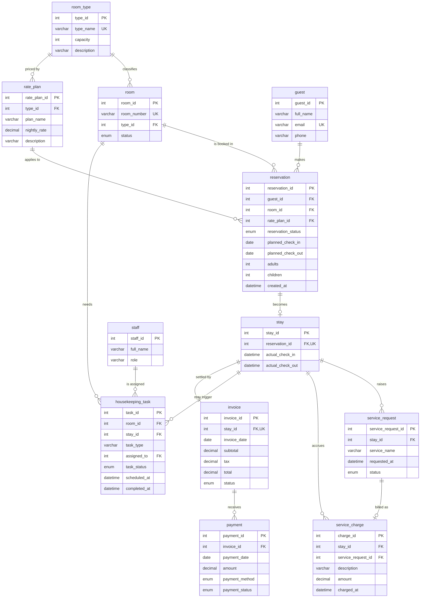

# Hotel Reservation and Guest Services Management System

**Project 12 · DBMS Project-Based Learning (PBL)**
Dandigam Ritheek · AI-ML · Woxsen University · Student ID 25WU0102057 · 2026

A relational database system in MySQL 8, normalized to 3NF, for managing hotel rooms, reservations, guest stays, in-stay services, housekeeping and billing. Business rules are enforced inside the database (10 triggers, 8 CHECK constraints), and three front ends sit on top of it.

| | |
|---|---|
| **Live demo** | https://ritheekyadav01-afk.github.io/taj-ritheek/ (sample data runs in the browser) |
| **Video presentation (5 min)** | see [`video/VIDEO_LINK.md`](./video/VIDEO_LINK.md) |
| **Final report** | [`report/Final_Report.pdf`](./report/Final_Report.pdf) |

## Submission contents

| Item | Location |
|---|---|
| Review 1 deck (PDF) | [`review-1/Review1_Hotel_Deck.pdf`](./review-1/Review1_Hotel_Deck.pdf) |
| Review 2 deck (PDF) | [`review-2/Review2_Hotel_Deck.pdf`](./review-2/Review2_Hotel_Deck.pdf) |
| Review 3 (final) deck (PDF) | [`review-3/Review3_Hotel_Deck.pdf`](./review-3/Review3_Hotel_Deck.pdf) |
| Final report (PDF) | [`report/Final_Report.pdf`](./report/Final_Report.pdf) |
| ER diagram | below, and [`docs/er_diagram.png`](./docs/er_diagram.png) |
| Working prototype | [`review-3/`](./review-3) |
| Video link document | [`video/VIDEO_LINK.md`](./video/VIDEO_LINK.md) |

## ER diagram

Rendered from the implemented schema (`review-3/db/01_schema.sql`). 12 tables, 14 foreign keys.



## Repository layout

```
review-1/   problem statement, scope, initial ER and schema (deck)
review-2/   normalization, data dictionary, DDL, triggers, sample data, queries (deck + sql/)
review-3/   final deck and the working prototype
  db/         01_schema.sql ... 05_queries.sql
  app/        Python command-line app
  app_web/    Streamlit web UI
  app_site/   React + Vite front end, Flask API, tests ("Taj Ritheek")
  docs/       how-to-run guides, validation tests, sample run logs
report/     final report (PDF)
video/      link to the 5-minute video presentation
```

## Design highlights

- **3NF** with two documented exceptions (`service_charge.stay_id`, `housekeeping_task.room_id`), guarded by triggers.
- **8 business rules in the database:** no overlapping bookings, occupants within capacity, check-out after check-in, non-negative charges, no overpayment, rate plan matches room type, charge stay matches request stay, task room matches stay room.
- **8 reporting views:** current occupancy, vacant rooms, cancellations, housekeeping status, guest history, service revenue, total revenue, occupancy rate.
- **Atomic operations:** every multi-step action runs as one transaction; all SQL is parameterized.

## Run the prototype

Requirements: MySQL 8, Python 3.10+, Node 18+ (only for the React site).

```bash
# 1. Create the database (from the repo root)
mysql -u root -p < review-3/db/01_schema.sql
mysql -u root -p hotel_pbl < review-3/db/02_triggers.sql
mysql -u root -p hotel_pbl < review-3/db/03_sample_data.sql
mysql -u root -p hotel_pbl < review-3/db/04_views_reports.sql

# 2. Configure credentials (never committed)
cp review-3/app/.env.example review-3/app/.env     # then edit the password

# 3a. Command-line app
pip install -r review-3/app/requirements.txt
python review-3/app/main.py

# 3b. Streamlit web UI
pip install -r review-3/app_web/requirements.txt
streamlit run review-3/app_web/app.py

# 3c. React + Flask site
bash review-3/app_site/run.sh
```

Detailed guides: [`how_to_run.md`](./review-3/docs/how_to_run.md), [`how_to_run_web.md`](./review-3/docs/how_to_run_web.md), [`how_to_run_site.md`](./review-3/docs/how_to_run_site.md). Test results: [`validation_tests.md`](./review-3/docs/validation_tests.md).
